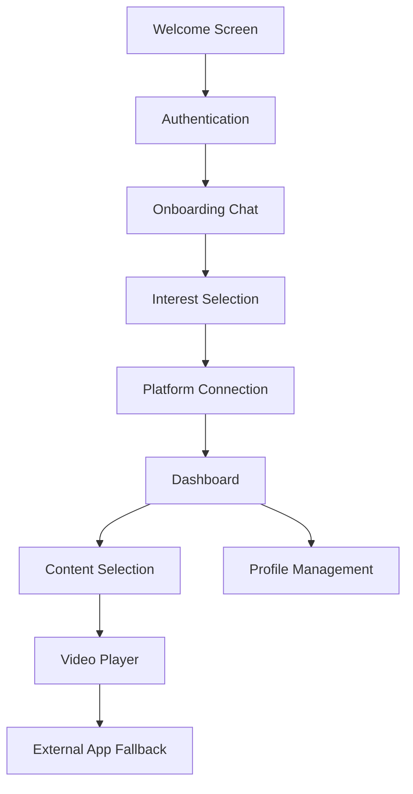

# Afeedi App - Comprehensive Analysis and Improvement Plan

## 1. Product Overview

Afeedi is a Flutter-based social media aggregation platform that consolidates content from multiple platforms (YouTube, TikTok, Instagram, Facebook) into a unified viewing experience. The app aims to provide personalized content recommendations through an AI-powered chatbot interface and seamless video playback across different social media platforms.

The current implementation faces critical issues with video playback functionality, chat interface limitations, and design inconsistencies that significantly impact user experience and platform viability.

## 2. Core Features

### 2.1 User Roles

| Role | Registration Method | Core Permissions |
|------|---------------------|------------------|
| Guest User | No registration required | Browse content, limited recommendations |
| Registered User | Email/Social OAuth | Full personalization, content saving, platform connections |
| Premium User | Subscription upgrade | Ad-free experience, advanced features, priority support |

### 2.2 Feature Module

Our comprehensive app consists of the following main pages:
1. **Welcome Screen**: Hero section, social login options, account creation, design consistency
2. **Onboarding Chat Interface**: AI-powered chatbot, preference collection, platform connections
3. **Dashboard Screen**: Personalized feed, content recommendations, platform integration
4. **Video Player Interface**: Multi-platform video playback, streaming optimization, content-only display
5. **Profile Management**: User preferences, connected platforms, viewing habits
6. **Content Feed**: Aggregated content display, filtering options, recommendation engine

### 2.3 Page Details

| Page Name | Module Name | Feature Description |
|-----------|-------------|---------------------|
| Welcome Screen | Hero Section | Animated gradient background, logo display, brand messaging |
| Welcome Screen | Authentication Options | Google/Apple OAuth, email registration, login functionality |
| Welcome Screen | Navigation Controls | Skip option, terms/privacy links, smooth transitions |
| Onboarding Chat | AI Chatbot Interface | Natural language processing, step-by-step preference collection |
| Onboarding Chat | Quick Reply System | Predefined response options, genre selection, platform connections |
| Onboarding Chat | Progress Tracking | Visual progress indicators, analytics integration, completion celebration |
| Dashboard | Content Feed | Aggregated content display, infinite scroll, pull-to-refresh |
| Dashboard | Recommendation Engine | AI-powered suggestions, personalization algorithms, content filtering |
| Video Player | Multi-Platform Support | YouTube/TikTok/Instagram integration, embedded playback, external fallback |
| Video Player | Streaming Optimization | Adaptive quality, browser compatibility, performance monitoring |
| Profile Management | Platform Connections | OAuth integration, connection status, account linking |
| Profile Management | Preference Settings | Interest categories, viewing habits, notification preferences |

## 3. Core Process

### User Onboarding Flow
1. User lands on Welcome Screen with animated introduction
2. User selects authentication method (social OAuth or email registration)
3. System initiates onboarding chatbot for preference collection
4. User interacts with AI assistant to select interests and connect platforms
5. System generates personalized content recommendations
6. User is directed to main dashboard with curated feed

### Content Discovery Flow
1. User browses personalized dashboard feed
2. User selects content item for viewing
3. System attempts in-app video playback with platform-specific optimization
4. If in-app playback fails, system provides external app fallback
5. User interactions are tracked for recommendation improvement



## 4. User Interface Design

### 4.1 Design Style
- **Primary Colors**: Deep purple gradient (#0D0B1E to #2D1B69), Cyan accent (#00D4FF)
- **Secondary Colors**: Pink accent (#FF6B9D), White text (#FFFFFF), Semi-transparent overlays
- **Button Style**: Rounded corners (12px radius), gradient backgrounds, outlined variants
- **Typography**: System fonts, bold headings (32px), body text (16-18px), subtle letter spacing
- **Layout Style**: Card-based design, backdrop blur effects, animated transitions
- **Animation Style**: Smooth fade/slide transitions, confetti celebrations, typing indicators

### 4.2 Page Design Overview

| Page Name | Module Name | UI Elements |
|-----------|-------------|-------------|
| Welcome Screen | Background | Gradient overlay, radial blur effects, animated particles |
| Welcome Screen | Logo | Circular gradient container, play icon, 80px dimensions |
| Welcome Screen | Authentication | Full-width buttons, social icons, consistent spacing |
| Onboarding Chat | Chat Interface | Message bubbles, typing indicators, smooth scrolling |
| Onboarding Chat | Input Controls | Text field, quick reply chips, send button |
| Dashboard | Content Cards | Rounded corners, shadow effects, platform indicators |
| Video Player | Controls | Custom overlay, platform-specific styling, responsive design |

### 4.3 Responsiveness
The app is designed mobile-first with adaptive layouts for tablet and desktop web deployment. Touch interactions are optimized for mobile devices with appropriate tap targets and gesture support.

## 5. Current Implementation Analysis

### 5.1 Welcome Screen Issues

**Current Problems:**
- Authentication buttons redirect to onboarding instead of actual OAuth flows
- Missing proper social login integration (Google Sign-In disabled in pubspec.yaml)
- Design inconsistencies with app theme colors
- Skip functionality bypasses essential user setup

**Technical Issues:**
```dart
// Current problematic implementation
onPressed: () {
  Navigator.pushNamed(context, AppRoutes.onboardingChatbot); // Should trigger OAuth
}
```

### 5.2 Chat Interface Limitations

**Current Problems:**
- Over-complex onboarding flow (1797 lines in single file)
- Limited natural language processing capabilities
- No direct question input during initial steps
- Inconsistent animation performance
- Missing conversation context preservation

**Technical Issues:**
- Hardcoded conversation flow without flexibility
- Memory leaks in animation controllers
- Poor separation of concerns (UI/business logic mixed)

### 5.3 Video Playback Critical Issues

**Current Problems:**
- YouTube/TikTok videos redirect to external apps instead of in-app playback
- Browser streaming service incomplete implementation
- WebView integration failures on mobile platforms
- No content-only display mode (shows platform UI elements)
- Poor error handling and fallback mechanisms

**Technical Analysis:**
```dart
// Current failing implementation
Future<YouTubePlayerResult> _createWebPlayer() async {
  // TODO: Implement proper iframe creation for web platform
  final iframe = null; // Simplified for mobile-first approach
  // This causes all web playback to fail
}
```

### 5.4 Architecture Problems

**Dependency Issues:**
- Google Sign-In disabled due to dependency conflicts
- Firebase services temporarily disabled
- Supabase integration removed but not replaced
- Missing proper state management for video playback

**Service Layer Issues:**
- Browser streaming service incomplete
- Universal platform player service has hardcoded fallbacks
- No proper error recovery mechanisms
- Analytics integration incomplete

## 6. Technical Architecture Analysis

### 6.1 Current Tech Stack
- **Frontend**: Flutter 3.9.0 with Riverpod state management
- **UI Components**: Material Design with custom theming
- **Video Playback**: webview_flutter 4.7.0, url_launcher 6.2.6
- **Authentication**: flutter_facebook_auth, sign_in_with_apple (Google disabled)
- **Local Storage**: Hive 2.2.3, shared_preferences 2.2.3
- **HTTP**: dio 5.4.3, http 1.2.1
- **Analytics**: Custom implementation (incomplete)

### 6.2 Identified Technical Debt

1. **Video Streaming Architecture**
   - No proper iframe management for web
   - Missing HLS/DASH streaming support
   - Platform-specific players not properly implemented
   - No content extraction capabilities

2. **Authentication System**
   - OAuth flows incomplete
   - Social login buttons non-functional
   - User session management inadequate

3. **State Management**
   - Mixed use of setState and Riverpod
   - No proper video player state management
   - Chat conversation state not persisted

## 7. Improvement Roadmap

### Phase 1: Foundation Fixes (Week 1-2)

#### 7.1 Welcome Screen Restoration
- **Fix OAuth Integration**: Re-enable Google Sign-In, implement proper social authentication
- **Design Consistency**: Update color scheme to match app theme
- **Functional Authentication**: Connect buttons to actual auth services instead of navigation
- **Enhanced Animations**: Optimize performance and add loading states

#### 7.2 Chat Interface Enhancement
- **Modular Architecture**: Split large onboarding file into smaller components
- **Direct Input**: Add immediate text input capability
- **Smart Suggestions**: Implement contextual quick replies
- **Conversation Memory**: Persist chat state across sessions

### Phase 2: Video Playback Solution (Week 3-4)

#### 7.3 Browser Streaming Implementation
- **Rust Browser Integration**: Research and implement Tauri-based solution for content extraction
- **Content-Only Display**: Strip platform UI elements, show only video content
- **Adaptive Streaming**: Implement HLS/DASH support for quality optimization
- **Fallback Mechanisms**: Graceful degradation to external apps when needed

#### 7.4 Platform Integration
- **YouTube API**: Implement proper embed player with content extraction
- **TikTok Integration**: Custom player implementation for in-app viewing
- **Instagram/Facebook**: OAuth and content access improvements
- **Universal Player**: Unified interface for all platform types

### Phase 3: Architecture Optimization (Week 5-6)

#### 7.5 State Management Overhaul
- **Riverpod Migration**: Complete migration from setState to Riverpod
- **Video Player State**: Implement proper playback state management
- **User Preferences**: Centralized preference management system
- **Offline Support**: Cache management for content and user data

#### 7.6 Performance Optimization
- **Memory Management**: Fix animation controller leaks
- **Lazy Loading**: Implement efficient content loading strategies
- **Image Optimization**: Enhance cached_network_image usage
- **Bundle Size**: Optimize dependencies and remove unused code

## 8. Implementation Specifications

### 8.1 Video Playback Solution

**Rust Browser Integration:**
```rust
// Proposed Tauri-based content extractor
use tauri::command;
use webkit2gtk::WebView;

#[command]
async fn extract_video_content(url: String) -> Result<VideoContent, String> {
    // Implementation for content-only extraction
    // Remove platform UI, ads, and navigation
    // Return clean video stream URL
}
```

**Flutter Integration:**
```dart
// Enhanced video player service
class EnhancedVideoPlayerService {
  Future<VideoPlayerResult> createPlayer({
    required Content content,
    bool contentOnly = true,
  }) async {
    if (contentOnly) {
      // Use Rust extractor for clean content
      final extractedContent = await _rustExtractor.extract(content.url);
      return _createCleanPlayer(extractedContent);
    }
    // Fallback to standard embed
    return _createEmbedPlayer(content);
  }
}
```

### 8.2 Chat Interface Enhancement

**Modular Chat Components:**
```dart
// Separated chat components
class ChatMessage extends StatelessWidget {
  final String text;
  final bool isBot;
  final DateTime timestamp;
  
  // Clean, reusable message component
}

class ChatInputField extends StatefulWidget {
  final Function(String) onSend;
  final List<String> suggestions;
  
  // Enhanced input with suggestions
}

class ChatSuggestions extends StatelessWidget {
  final List<String> suggestions;
  final Function(String) onSelect;
  
  // Smart suggestion chips
}
```

### 8.3 Authentication System

**OAuth Integration:**
```dart
// Proper OAuth implementation
class AuthenticationService {
  Future<AuthResult> signInWithGoogle() async {
    try {
      final GoogleSignInAccount? googleUser = await GoogleSignIn().signIn();
      final GoogleSignInAuthentication? googleAuth = await googleUser?.authentication;
      
      // Create credential and authenticate
      final credential = GoogleAuthProvider.credential(
        accessToken: googleAuth?.accessToken,
        idToken: googleAuth?.idToken,
      );
      
      return await _processAuthentication(credential);
    } catch (error) {
      return AuthResult.failure(error.toString());
    }
  }
}
```

## 9. Success Metrics

### 9.1 Technical Metrics
- **Video Playback Success Rate**: Target 95% in-app playback success
- **Authentication Conversion**: Target 80% successful OAuth completions
- **App Performance**: Target <3s initial load time, <1s navigation
- **Crash Rate**: Target <0.1% crash rate across all platforms

### 9.2 User Experience Metrics
- **Onboarding Completion**: Target 85% completion rate
- **Chat Engagement**: Target 70% users complete full conversation
- **Content Discovery**: Target 60% users find relevant content within 2 minutes
- **Platform Connection**: Target 75% users connect at least 2 platforms

## 10. Risk Assessment

### 10.1 Technical Risks
- **Rust Integration Complexity**: Tauri integration may require significant development time
- **Platform API Changes**: YouTube/TikTok may modify embed policies
- **Performance Impact**: Content extraction may affect app performance
- **Cross-Platform Compatibility**: Rust components may have platform-specific issues

### 10.2 Mitigation Strategies
- **Phased Implementation**: Gradual rollout with fallback mechanisms
- **API Monitoring**: Continuous monitoring of platform API changes
- **Performance Testing**: Comprehensive testing across devices and platforms
- **Alternative Solutions**: Backup plans for each major component

This comprehensive analysis provides a clear roadmap for transforming Afeedi into a robust, user-friendly social media aggregation platform with superior video playback capabilities and an intuitive chat-based onboarding experience.