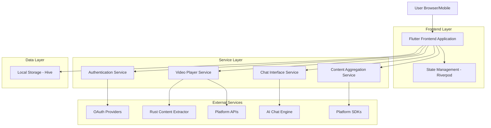
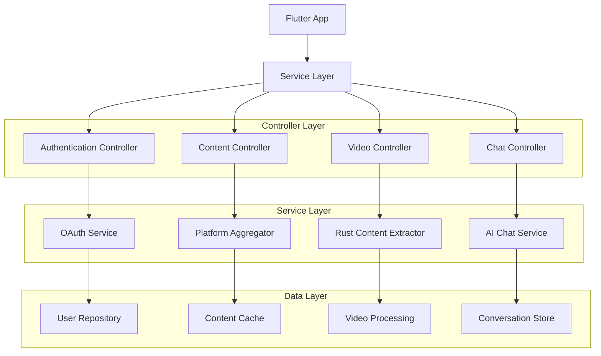
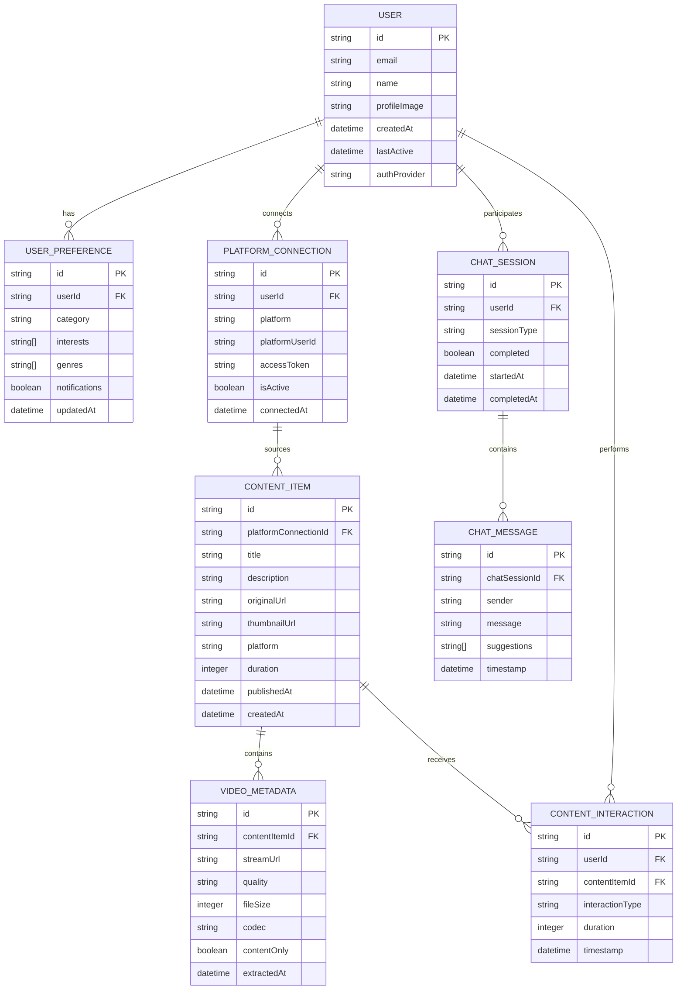

# Afeedi App - Technical Architecture Document

## 1. Architecture Design



## 2. Technology Description

- **Frontend**: Flutter@3.9.0 + Riverpod@2.5.1 + Material Design
- **Video Processing**: Rust/Tauri + webview_flutter@4.7.0
- **Authentication**: OAuth 2.0 (Google, Apple, Facebook)
- **Local Storage**: Hive@2.2.3 + shared_preferences@2.2.3
- **HTTP Client**: dio@5.4.3 + http@1.2.1
- **State Management**: flutter_riverpod@2.5.1
- **UI Components**: cached_network_image@3.3.1 + lottie@3.1.2

## 3. Route Definitions

| Route | Purpose |
|-------|---------|
| /welcome | Welcome screen with authentication options and app introduction |
| /onboarding | Enhanced chat-based onboarding flow with AI assistant |
| /dashboard | Main content feed with personalized recommendations |
| /video-player | Full-screen video player with platform-specific optimization |
| /profile | User profile management and platform connections |
| /settings | App preferences and account settings |
| /auth/callback | OAuth callback handling for social authentication |

## 4. API Definitions

### 4.1 Authentication APIs

**OAuth Authentication**
```
POST /api/auth/oauth/google
```

Request:
| Param Name | Param Type | isRequired | Description |
|------------|------------|------------|-------------|
| idToken | string | true | Google ID token from OAuth flow |
| accessToken | string | true | Google access token |

Response:
| Param Name | Param Type | Description |
|------------|------------|-------------|
| success | boolean | Authentication status |
| user | UserProfile | User profile information |
| token | string | App authentication token |

Example:
```json
{
  "idToken": "eyJhbGciOiJSUzI1NiIs...",
  "accessToken": "ya29.a0AfH6SMC..."
}
```

**User Profile Management**
```
GET /api/user/profile
PUT /api/user/preferences
```

### 4.2 Content APIs

**Content Aggregation**
```
GET /api/content/feed
```

Request:
| Param Name | Param Type | isRequired | Description |
|------------|------------|------------|-------------|
| userId | string | true | User identifier |
| platform | string | false | Filter by platform (youtube, tiktok, instagram) |
| limit | integer | false | Number of items to return (default: 20) |
| offset | integer | false | Pagination offset |

Response:
| Param Name | Param Type | Description |
|------------|------------|-------------|
| content | ContentItem[] | Array of content items |
| hasMore | boolean | Whether more content is available |
| nextOffset | integer | Next pagination offset |

**Video Content Extraction**
```
POST /api/video/extract
```

Request:
| Param Name | Param Type | isRequired | Description |
|------------|------------|------------|-------------|
| url | string | true | Original platform video URL |
| contentOnly | boolean | false | Extract content without platform UI |
| quality | string | false | Preferred quality (auto, 720p, 1080p) |

Response:
| Param Name | Param Type | Description |
|------------|------------|-------------|
| streamUrl | string | Direct video stream URL |
| thumbnail | string | Video thumbnail URL |
| duration | integer | Video duration in seconds |
| metadata | VideoMetadata | Additional video information |

### 4.3 Chat Interface APIs

**Chat Conversation**
```
POST /api/chat/message
```

Request:
| Param Name | Param Type | isRequired | Description |
|------------|------------|------------|-------------|
| message | string | true | User message text |
| sessionId | string | true | Chat session identifier |
| context | ChatContext | false | Conversation context |

Response:
| Param Name | Param Type | Description |
|------------|------------|-------------|
| response | string | AI assistant response |
| suggestions | string[] | Quick reply suggestions |
| nextStep | string | Next onboarding step |
| completed | boolean | Whether onboarding is complete |

## 5. Server Architecture Diagram



## 6. Data Model

### 6.1 Data Model Definition



### 6.2 Data Definition Language

**User Management Tables**
```sql
-- Users table
CREATE TABLE users (
    id UUID PRIMARY KEY DEFAULT gen_random_uuid(),
    email VARCHAR(255) UNIQUE NOT NULL,
    name VARCHAR(100) NOT NULL,
    profile_image VARCHAR(500),
    created_at TIMESTAMP WITH TIME ZONE DEFAULT NOW(),
    last_active TIMESTAMP WITH TIME ZONE DEFAULT NOW(),
    auth_provider VARCHAR(50) NOT NULL
);

-- User preferences
CREATE TABLE user_preferences (
    id UUID PRIMARY KEY DEFAULT gen_random_uuid(),
    user_id UUID NOT NULL REFERENCES users(id) ON DELETE CASCADE,
    category VARCHAR(50) NOT NULL,
    interests TEXT[] DEFAULT '{}',
    genres TEXT[] DEFAULT '{}',
    notifications BOOLEAN DEFAULT true,
    updated_at TIMESTAMP WITH TIME ZONE DEFAULT NOW()
);

-- Platform connections
CREATE TABLE platform_connections (
    id UUID PRIMARY KEY DEFAULT gen_random_uuid(),
    user_id UUID NOT NULL REFERENCES users(id) ON DELETE CASCADE,
    platform VARCHAR(50) NOT NULL,
    platform_user_id VARCHAR(255) NOT NULL,
    access_token TEXT,
    is_active BOOLEAN DEFAULT true,
    connected_at TIMESTAMP WITH TIME ZONE DEFAULT NOW()
);
```

**Content Management Tables**
```sql
-- Content items
CREATE TABLE content_items (
    id UUID PRIMARY KEY DEFAULT gen_random_uuid(),
    platform_connection_id UUID NOT NULL REFERENCES platform_connections(id),
    title VARCHAR(500) NOT NULL,
    description TEXT,
    original_url VARCHAR(1000) NOT NULL,
    thumbnail_url VARCHAR(1000),
    platform VARCHAR(50) NOT NULL,
    duration INTEGER,
    published_at TIMESTAMP WITH TIME ZONE,
    created_at TIMESTAMP WITH TIME ZONE DEFAULT NOW()
);

-- Video metadata
CREATE TABLE video_metadata (
    id UUID PRIMARY KEY DEFAULT gen_random_uuid(),
    content_item_id UUID NOT NULL REFERENCES content_items(id) ON DELETE CASCADE,
    stream_url VARCHAR(1000),
    quality VARCHAR(20),
    file_size BIGINT,
    codec VARCHAR(50),
    content_only BOOLEAN DEFAULT false,
    extracted_at TIMESTAMP WITH TIME ZONE DEFAULT NOW()
);
```

**Chat System Tables**
```sql
-- Chat sessions
CREATE TABLE chat_sessions (
    id UUID PRIMARY KEY DEFAULT gen_random_uuid(),
    user_id UUID NOT NULL REFERENCES users(id) ON DELETE CASCADE,
    session_type VARCHAR(50) NOT NULL DEFAULT 'onboarding',
    completed BOOLEAN DEFAULT false,
    started_at TIMESTAMP WITH TIME ZONE DEFAULT NOW(),
    completed_at TIMESTAMP WITH TIME ZONE
);

-- Chat messages
CREATE TABLE chat_messages (
    id UUID PRIMARY KEY DEFAULT gen_random_uuid(),
    chat_session_id UUID NOT NULL REFERENCES chat_sessions(id) ON DELETE CASCADE,
    sender VARCHAR(20) NOT NULL CHECK (sender IN ('user', 'bot')),
    message TEXT NOT NULL,
    suggestions TEXT[] DEFAULT '{}',
    timestamp TIMESTAMP WITH TIME ZONE DEFAULT NOW()
);
```

**Analytics Tables**
```sql
-- Content interactions
CREATE TABLE content_interactions (
    id UUID PRIMARY KEY DEFAULT gen_random_uuid(),
    user_id UUID NOT NULL REFERENCES users(id) ON DELETE CASCADE,
    content_item_id UUID NOT NULL REFERENCES content_items(id) ON DELETE CASCADE,
    interaction_type VARCHAR(50) NOT NULL,
    duration INTEGER,
    timestamp TIMESTAMP WITH TIME ZONE DEFAULT NOW()
);
```

**Indexes for Performance**
```sql
-- User-related indexes
CREATE INDEX idx_users_email ON users(email);
CREATE INDEX idx_users_last_active ON users(last_active DESC);

-- Content-related indexes
CREATE INDEX idx_content_items_platform ON content_items(platform);
CREATE INDEX idx_content_items_published_at ON content_items(published_at DESC);
CREATE INDEX idx_content_items_platform_connection ON content_items(platform_connection_id);

-- Chat-related indexes
CREATE INDEX idx_chat_sessions_user_id ON chat_sessions(user_id);
CREATE INDEX idx_chat_messages_session_id ON chat_messages(chat_session_id);
CREATE INDEX idx_chat_messages_timestamp ON chat_messages(timestamp DESC);

-- Analytics indexes
CREATE INDEX idx_content_interactions_user_id ON content_interactions(user_id);
CREATE INDEX idx_content_interactions_content_id ON content_interactions(content_item_id);
CREATE INDEX idx_content_interactions_timestamp ON content_interactions(timestamp DESC);
```

**Initial Data**
```sql
-- Default user preferences categories
INSERT INTO user_preferences (user_id, category, interests, genres) VALUES
('00000000-0000-0000-0000-000000000000', 'content_types', 
 ARRAY['music', 'comedy', 'education', 'gaming', 'lifestyle'], 
 ARRAY['pop', 'rock', 'hip-hop', 'electronic']);

-- Platform configuration
INSERT INTO platform_connections (user_id, platform, platform_user_id, is_active) VALUES
('00000000-0000-0000-0000-000000000000', 'youtube', 'demo_user', true),
('00000000-0000-0000-0000-000000000000', 'tiktok', 'demo_user', true);
```

This technical architecture provides a robust foundation for the Afeedi app with proper separation of concerns, scalable data models, and comprehensive API definitions for all major functionality.