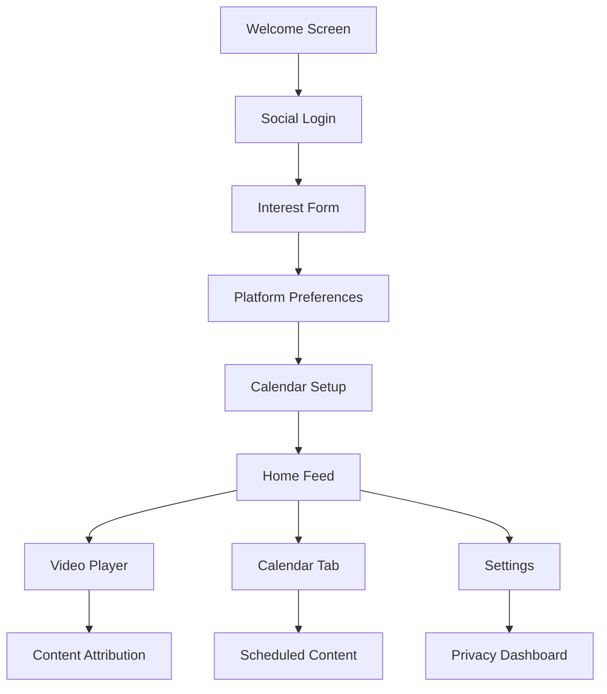
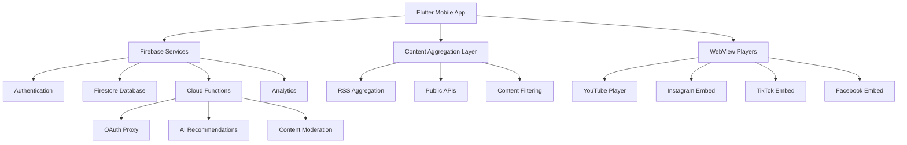
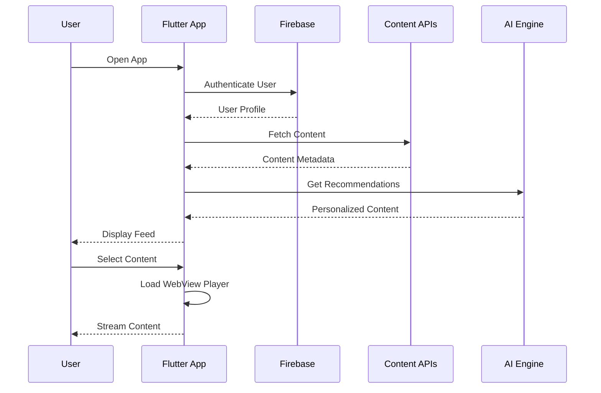

# Afeedi - Product Requirements Document

## 1. Product Overview

Afeedi is a revolutionary browser-based video streaming platform that provides unlimited video consumption with zero API costs through embedded content streaming from YouTube, Instagram, TikTok, and Facebook while maintaining full platform attribution and app store compliance.

The platform solves the critical problem of expensive API quotas for video content aggregation by utilizing RSS feeds, public APIs, and embedded WebView players. Target users include content consumers seeking personalized video experiences across multiple platforms without the limitations of individual platform apps.

The product aims to capture the growing market of cross-platform content consumption while ensuring complete legal compliance and app store approval.

## 2. Core Features

### 2.1 User Roles

| Role | Registration Method | Core Permissions |
|------|---------------------|------------------|
| Guest User | No registration required | Browse public content, limited features |
| Registered User | Email/Social OAuth | Full content access, personalization, calendar integration |
| Premium User | Subscription upgrade | Advanced AI features, unlimited content, priority support |

### 2.2 Feature Module

Our Afeedi application consists of the following main pages:

1. **Welcome Screen**: App introduction, mascot presentation, feature highlights
2. **Social Login Screen**: OAuth authentication, platform connections, privacy controls
3. **Interest & Personal Info Form**: User preferences, content categories, personalization setup
4. **Source Preference Slider**: Platform selection, content source prioritization
5. **Calendar Customization**: Content scheduling, reminder setup, integration preferences
6. **Home Feed**: Personalized content stream, AI recommendations, infinite scroll
7. **Videos Tab**: Full-screen video player, platform-specific content, attribution display
8. **Calendar Tab**: Content planner, scheduled viewing, AI-powered suggestions
9. **Settings Tab**: Privacy controls, account management, app preferences
10. **Profile Screen**: User statistics, viewing history, achievement tracking

### 2.3 Page Details

| Page Name | Module Name | Feature Description |
|-----------|-------------|---------------------|
| Welcome Screen | Hero Section | Display app mascot (Lumpty), feature highlights, onboarding initiation |
| Welcome Screen | Navigation | Quick access to login, demo mode, accessibility options |
| Social Login Screen | OAuth Integration | Google, Apple, Facebook authentication with comprehensive token management |
| Social Login Screen | Privacy Controls | Granular permission settings, data collection transparency |
| Interest Form | Category Selection | Multi-platform content preferences, topic interests, learning goals |
| Interest Form | Personalization Engine | AI-driven preference analysis, recommendation algorithm initialization |
| Source Preference | Platform Slider | YouTube, Instagram, TikTok, Facebook priority configuration |
| Source Preference | Attribution Display | Creator credit settings, platform branding preferences |
| Calendar Customization | Schedule Setup | Content viewing times, reminder preferences, integration options |
| Calendar Customization | AI Suggestions | Smart scheduling based on content type and user behavior |
| Home Feed | Content Stream | Infinite scroll feed, multi-platform content aggregation |
| Home Feed | AI Recommendations | Personalized content suggestions, diversification algorithms |
| Home Feed | Mascot Integration | Interactive AI companion, contextual assistance |
| Videos Tab | Universal Player | WebView-based video streaming, platform-specific optimizations |
| Videos Tab | Attribution System | Automatic creator credit, platform branding, compliance monitoring |
| Videos Tab | Performance Optimization | Preloading, caching, memory management |
| Calendar Tab | Content Planner | Scheduled content viewing, calendar integration |
| Calendar Tab | Smart Scheduling | AI-powered content recommendations based on time and context |
| Settings Tab | Privacy Dashboard | GDPR/CCPA compliance, data management, consent controls |
| Settings Tab | Account Management | Profile settings, subscription management, security options |
| Settings Tab | App Preferences | Theme selection, notification settings, performance options |

## 3. Core Process

### User Onboarding Flow
1. User opens app and views welcome screen with mascot introduction
2. User selects authentication method (OAuth or guest mode)
3. User completes interest and personal information form
4. User configures platform preferences and content sources
5. User sets up calendar integration and scheduling preferences
6. User enters main application with personalized home feed

### Content Discovery and Consumption Flow
1. User browses personalized home feed with AI recommendations
2. User selects content from multiple platforms (YouTube, Instagram, TikTok, Facebook)
3. Universal video player loads content with proper attribution
4. User interacts with content (like, save, schedule)
5. AI engine learns from user behavior and updates recommendations
6. User can schedule content for later viewing via calendar integration

### Privacy and Compliance Flow
1. User accesses privacy dashboard in settings
2. User reviews data collection and usage transparency
3. User configures granular privacy preferences
4. System ensures GDPR/CCPA compliance with user choices
5. User can export, modify, or delete personal data
6. System maintains audit trail for compliance verification

## 4. User Interface Design

### 4.1 Design Style

- **Primary Colors**: Deep blue (#1E3A8A) for trust and professionalism, vibrant orange (#F97316) for energy and engagement
- **Secondary Colors**: Soft gray (#F3F4F6) for backgrounds, white (#FFFFFF) for content areas
- **Button Style**: Rounded corners (12px radius), subtle shadows, gradient backgrounds for primary actions
- **Typography**: Inter font family, 16px base size for body text, 24px for headings, 14px for captions
- **Layout Style**: Card-based design with generous whitespace, top navigation with bottom tab bar
- **Icons**: Outlined style with 2px stroke width, consistent sizing (24px standard)
- **Animations**: Smooth transitions (300ms duration), spring animations for interactions

### 4.2 Page Design Overview

| Page Name | Module Name | UI Elements |
|-----------|-------------|-------------|
| Welcome Screen | Hero Section | Large mascot animation, gradient background, bold typography, floating action buttons |
| Welcome Screen | Feature Highlights | Horizontal card carousel, icon-text pairs, subtle animations |
| Social Login | OAuth Buttons | Platform-branded buttons, secure connection indicators, privacy badges |
| Social Login | Privacy Notice | Collapsible information panels, clear consent checkboxes |
| Interest Form | Category Grid | Multi-select cards with visual icons, progress indicator, smart suggestions |
| Interest Form | Personal Info | Clean form fields, real-time validation, accessibility labels |
| Platform Preferences | Slider Interface | Interactive sliders with platform logos, real-time preview |
| Platform Preferences | Attribution Preview | Sample content cards showing attribution display |
| Home Feed | Content Cards | Masonry layout, lazy loading, infinite scroll, pull-to-refresh |
| Home Feed | AI Recommendations | Highlighted recommendation sections, explanation tooltips |
| Video Player | Universal Interface | Full-screen capable, platform-specific controls, attribution overlay |
| Video Player | Performance Indicators | Loading states, quality indicators, error recovery options |
| Calendar Tab | Schedule View | Monthly/weekly/daily views, content thumbnails, drag-and-drop |
| Calendar Tab | Smart Suggestions | AI recommendation cards, scheduling assistance |
| Settings | Privacy Dashboard | Toggle switches, data usage meters, compliance indicators |
| Settings | Account Management | Profile cards, subscription status, security settings |

### 4.3 Responsiveness

The application is designed mobile-first with adaptive layouts for tablets and larger screens. Touch interactions are optimized with appropriate touch targets (minimum 44px), gesture support for navigation, and haptic feedback for user actions. The interface adapts to system accessibility settings including font scaling, high contrast modes, and screen reader compatibility.

## 5. Technical Architecture

### 5.1 System Architecture

Afeedi employs a hybrid architecture combining Flutter frontend with Firebase backend services and specialized content aggregation systems:

### 5.2 Data Flow Architecture

### 5.3 Security and Compliance Framework

The application implements comprehensive security measures including:
- End-to-end encryption for sensitive data
- OAuth 2.0 with PKCE for secure authentication
- WebView security policies preventing malicious content
- GDPR/CCPA compliance with automated data handling
- DMCA takedown system for copyright protection
- App store compliance monitoring and validation

### 5.4 Performance Optimization

- **Content Preloading**: Intelligent prefetching based on user behavior
- **Caching Strategy**: Multi-level caching for metadata, thumbnails, and content
- **Memory Management**: Efficient WebView lifecycle management
- **Network Optimization**: Adaptive quality streaming, offline mode support
- **Battery Optimization**: Background task management, efficient rendering

This comprehensive architecture ensures scalable, secure, and compliant operation while delivering exceptional user experience across all supported platforms.
